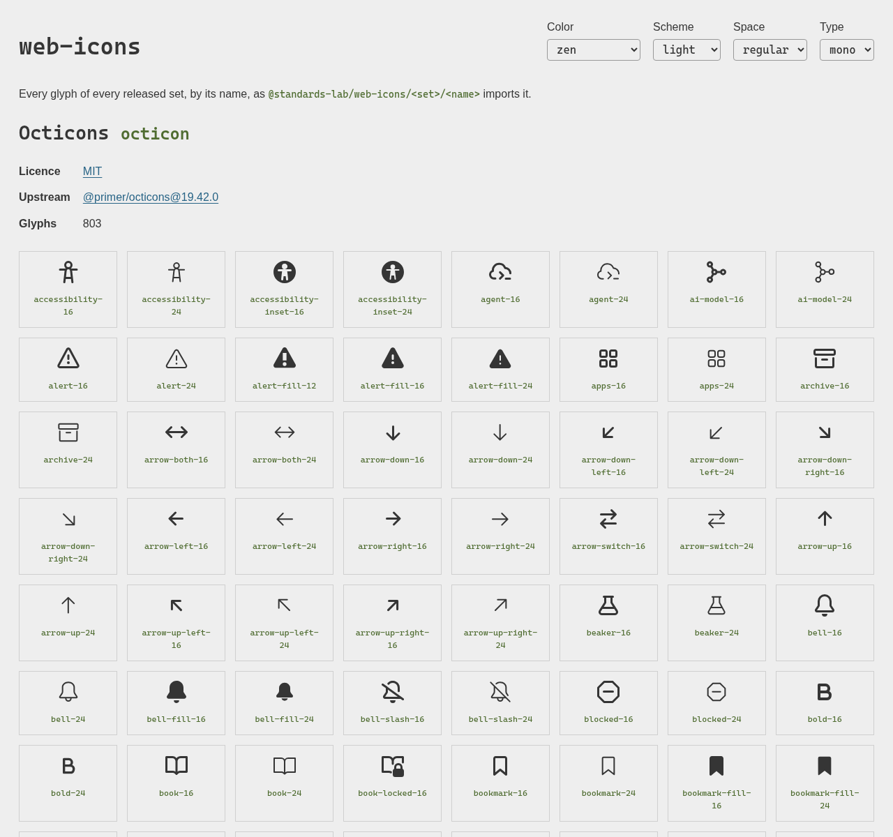

<!-- Adapted from spike-html-hosting-icons (8b8d955): README.md, for @standards-lab/web-icons, in
web-foundation's (72e759f) README shape, with spike-html-hosting-sdk's (f49087e) marker fill. -->

# web-icons

The icons of the standards-lab web client stack, and its iconography convention: every web client
and page draws its glyphs from here. Each icon is its own ES module whose default export is one
complete `<svg>` string, so a bundle carries only the icons it imports; and `iconFill()`, a Vite
plugin, fills a page's glyph markers with the same markup in dev and at build. A component imports
an icon's module and renders it with Lit's `unsafeHTML`; a page writes a marker and the plugin
fills it. The package has no runtime dependency, and its one peer, Vite, is optional. It sits on
web-foundation, below web-components and web-app-sdk.

It releases [Octicons](https://github.com/primer/octicons) 19.42.0 alone.

<picture>
  <source media="(prefers-color-scheme: dark)" srcset="https://raw.githubusercontent.com/standards-lab/web-icons/main/docs/preview-dark.png">
  
</picture>

## Install

Each release is a tag, `v<version>`, of
[standards-lab/web-icons](https://github.com/standards-lab/web-icons), whose tree is the package
as `pnpm pack` builds it: `package.json`, this README, the LICENSE, and `dist/`, the build. The
build lives only in the tag's tree, so the tag installs with no build step, and its manifest has no
scripts. Install it by the tag:

```
pnpm add github:standards-lab/web-icons#v0.1.0
bun add github:standards-lab/web-icons#v0.1.0
npm install --allow-git=root github:standards-lab/web-icons#v0.1.0
```

npm 12 refuses git dependencies unless `--allow-git` allows them; `root` allows the ones the
project itself declares. Each GitHub release also carries the tarball.

`vite` (`^8.3.8`) is an optional peer: a project that uses `iconFill()` has Vite already, and one
that imports only icon modules isn't asked for it.

## Use

The package is `@standards-lab/web-icons`.

- `./<set>/<name>`: an icon, imported by its set and its name with no extension, as
  `@standards-lab/web-icons/octicon/x-16`. Its default export is the icon's `<svg>`, a string: 1em
  square on its viewBox, so it takes the text's size; drawn in `currentColor`, so it takes the
  text's color; with `aria-hidden="true"` and `focusable="false"`, so the text or the label beside
  it names it and it never takes focus. Its declaration types it as a string.
- `./vite`: `iconFill()`, the Vite plugin that fills markers, with its declaration.

### In a component

A component imports the icons it draws and renders each with Lit's `unsafeHTML`. The markup is the
package's own, generated at its build, never a reader's input:

```ts
import { LitElement, html } from "lit";
import { unsafeHTML } from "lit/directives/unsafe-html.js";
import x from "@standards-lab/web-icons/octicon/x-16";

class CloseButton extends LitElement {
  render() {
    return html`<button class="glyph-button" aria-label="Close">${unsafeHTML(x)}</button>`;
  }
}
customElements.define("close-button", CloseButton);
```

A Vite build that imports two icons carries exactly their markup and no other icon's.

### In a page

A page writes an empty marker, `<svg data-icon="<set>/<name>"></svg>`, where a glyph goes:

```html
<button class="glyph-button" aria-label="Settings">
  <svg class="glyph" data-icon="octicon/gear-16"></svg>
</button>
<button class="glyph-button" aria-label="Close"><svg data-icon="octicon/x-16"></svg></button>
```

and its `vite.config` adds the plugin:

```ts
import { defineConfig } from "vite";
import { iconFill } from "@standards-lab/web-icons/vite";

export default defineConfig({
  plugins: [iconFill()],
});
```

`iconFill()` replaces each marker in every HTML page Vite serves in dev or writes at build with that
icon's `<svg>`. The marker's `class` carries over to the svg, so a page styles a glyph where it
places it; any other attribute is dropped. A page with no marker passes through unchanged, and a
filled page gains only the icons' markup, never a script. An HTML comment's text is neither filled
nor checked, so a comment may show a marker.

A marker whose name isn't `<set>/<name>`, or whose icon the package doesn't hold, fails with a
message naming the page and the icon; so does an svg holding `data-icon` that isn't an empty,
quoted marker, naming the page and its tag. The build fails with that message, and in dev the
page's request fails with it, so nothing reaches the browser half-filled. The plugin fills a page
before Vite's own HTML transforms read it, so dev and build fill the same page and fail with the
same message. It loads each icon from the module beside it in its own package, so the plugin and
its icons are always one release.

## Sets and licences

| Set | Import | Licence | Upstream |
| --- | --- | --- | --- |
| [Octicons](https://github.com/primer/octicons) | `octicon/<name>` | MIT | primer/octicons, tag `@primer/octicons@19.42.0` |

A set ships every icon Iconify marks visible, and every alias of a shipped icon, which carries its
parent's markup: Octicons ships 803 modules, 780 icons and 23 aliases. An icon Iconify marks
hidden, such as `alert`, doesn't ship, and neither does an alias that takes its parent's hidden
flag. From v0.1.0 on, a shipped name keeps resolving in every later release.

The package is Apache-2.0. `sets.json` lists the released sets, each read from its
`@iconify-json/*` devDependency. The generator accepts a set only when shipping its licence text
satisfies the licence: MIT, ISC, Apache-2.0, BSD-2-Clause, BSD-3-Clause, CC0-1.0, or Unlicense. It
refuses any other, CC-BY, CC-BY-SA, and GPL among them, naming the set and its licence, and leaves
`dist/` empty, so no accepted set built before it survives. It also refuses a set whose prefix
isn't its name, and an icon whose name isn't a safe file name or that isn't drawn in
`currentColor`.

`@iconify-json/*` ships no licence text, so each released set's upstream LICENSE is held in
`licenses/<set>/`, byte for byte, and `sets.json` records its sha256 and the upstream repository,
commit, and tag it was fetched from; the build fails when the held LICENSE doesn't match its
sha256. The build ships it as `dist/<set>/LICENSE`, beside `LICENSE.provenance`, the line naming
that repository and commit. Octicons' is primer/octicons' LICENSE at commit `9a274e2`, tag
`@primer/octicons@19.42.0`.

[docs/adding-a-set.md](https://github.com/standards-lab/web-icons/blob/main/docs/adding-a-set.md)
gives the three changes that add a set, and
[docs/glyph-source.md](https://github.com/standards-lab/web-icons/blob/main/docs/glyph-source.md)
where the glyph data comes from and what rests on Iconify.

## Development

[docs/development.md](https://github.com/standards-lab/web-icons/blob/main/docs/development.md)
gives the tasks, the browse page, the screenshots and preview commands, and the test tiers, and
[docs/internals.md](https://github.com/standards-lab/web-icons/blob/main/docs/internals.md)
holds the reasoning behind the configuration, the scripts, and the sources.

## Release

A release is an annotated `v<version>` tag on a pack commit: a commit, on no branch, whose tree is
the pack, the build included, and whose one parent is main's merge commit. The version is the one
`package.json` gives and `CHANGELOG.md` has a section for. A person cuts the tag by hand once the
check is green on the merge commit, from a clean checkout with the pins installed:

```
git fetch origin && git switch --detach origin/main
mise run check
tag=v$(node -p 'require("./package.json").version')
scratch=$(mktemp -d)
pnpm pack --pack-destination "$scratch"
tar -xzf "$scratch"/*.tgz -C "$scratch"
# The pack's package/ as a tree, through an index of its own, so the checkout's index and
# .gitignore (which ignores dist/) play no part; --force keeps any other ignore rule from
# dropping a file.
GIT_INDEX_FILE="$scratch/index" git --work-tree="$scratch/package" add --all --force .
tree=$(GIT_INDEX_FILE="$scratch/index" git write-tree)
commit=$(git commit-tree "$tree" -p HEAD -m "web-icons $tag")
git tag -a "$tag" -m "web-icons $tag" "$commit"
git push origin "refs/tags/$tag"
gh workflow run release.yml -f tag="$tag"
```

The release workflow is dispatched by hand with the tag, not run by the push: GitHub reads a tag
push's workflows from the tagged tree, and the pack commit's tree holds only the pack, so the
workflow runs from main's copy. It checks that the tag's commit has one parent, a merge commit on
main, whose `package.json` version the tag names; runs the check on that parent; packs it and holds
the tag's tree to the pack, file for file; and creates the GitHub release from the version's
`CHANGELOG.md` section, with the tarball attached. It never cuts a tag, and a pushed tag is never
changed or re-cut.

## Provenance

The package is seeded by copy from spike-html-hosting-icons at 8b8d955: the generator, its tests and
fixture sets, and the browse page and what serves it. The marker fill comes from
spike-html-hosting-sdk at f49087e, its `src/icons.ts`, made a Vite plugin of its own that fills in
dev as well as at build. The scaffold, the workflows, this README's shape, the CHANGELOG, and the
browse page's selects come from web-foundation at 72e759f. Both spikes are archived and never a
dependency. Each copied file that takes comments names each of its sources in a provenance line; the
JSON files' provenance is in `context/README.md`.

## License

[Apache License 2.0](LICENSE). Each icon set keeps its own licence, shipped beside its modules:
Octicons' is [MIT](licenses/octicon/LICENSE).
